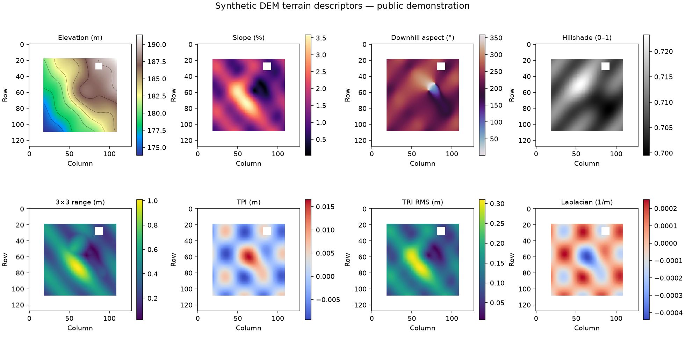

# Spatial Intelligence Engine — public showcase

“A modular spatial intelligence and decision-support engine that transforms DEM, DSM, DTM, LiDAR, survey, and geospatial datasets into engineering-ready insights for terrain, infrastructure, utilities, environmental analysis, and future ML-assisted workflows.”

“This repository contains a public demonstration subset of a larger privately developed platform. Certain production modules, domain logic, models, providers, and deployment components are intentionally excluded.”

This copy is an **independent, runnable terrain demonstration**, built with a small synthetic raster. It shows raster inspection, explicit CRS/unit checks, conservative NoData and AOI support, and deterministic terrain descriptors. It does not include the private application, client data, production analyses, or engineering acceptance logic.



## Run locally

Use Python 3.11+ and a fresh virtual environment:

```bash
python -m venv .venv
source .venv/bin/activate
python -m pip install -r requirements.txt
python examples/analyze_dem.py sample_data/synthetic_dem.tif --inspect-only
python examples/analyze_dem.py sample_data/synthetic_dem.tif --aoi sample_data/example_aoi.geojson
python -m unittest discover -s tests -v
```

The analysis writes `demo_output/result.json` and `demo_output/terrain_overview.png`. Both are ignored by Git. Regenerate the synthetic data with `python examples/make_synthetic_dem.py`; no source data is downloaded. The demonstration raster and AOI are wholly synthetic and contain no real site or client observations.

## What the demo calculates

On a north-up, projected metre grid with a declared metre vertical unit, the example computes elevation summary, central-difference slope and downhill aspect, hillshade, 3×3 elevation range (roughness), 3×3 topographic position index (TPI), root-mean-square neighbor difference (TRI), and discrete Laplacian curvature. The plot includes elevation contours. A 3×3 neighborhood must be fully valid for each derivative; edge, NoData, and AOI-boundary cells are excluded. Aspect is undefined on flat cells. No datum transformation, interpolation, hole filling, or physical-accuracy claim occurs.

The synthetic GeoTIFF declares `SURFACE_ROLE=DEM` and `VERTICAL_UNIT=metre`; its vertical reference is **unknown**. Those tags are source declarations, not independent verification. The example accepts only explicit DEM/DTM roles and metre XY/Z units. It refuses unsupported grids and missing declarations rather than silently converting coordinates or elevations. The optional AOI is a WGS84 GeoJSON polygon transformed to the declared raster CRS; pixel centers select cells, and all derivative support stays inside the AOI.

See [architecture](docs/ARCHITECTURE.md), [public scope](docs/PUBLIC_SCOPE.md), and [roadmap](docs/ROADMAP.md). No license has been selected for public distribution yet; review the contents and licensing before publication.
